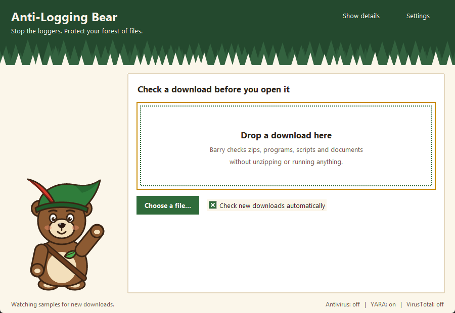
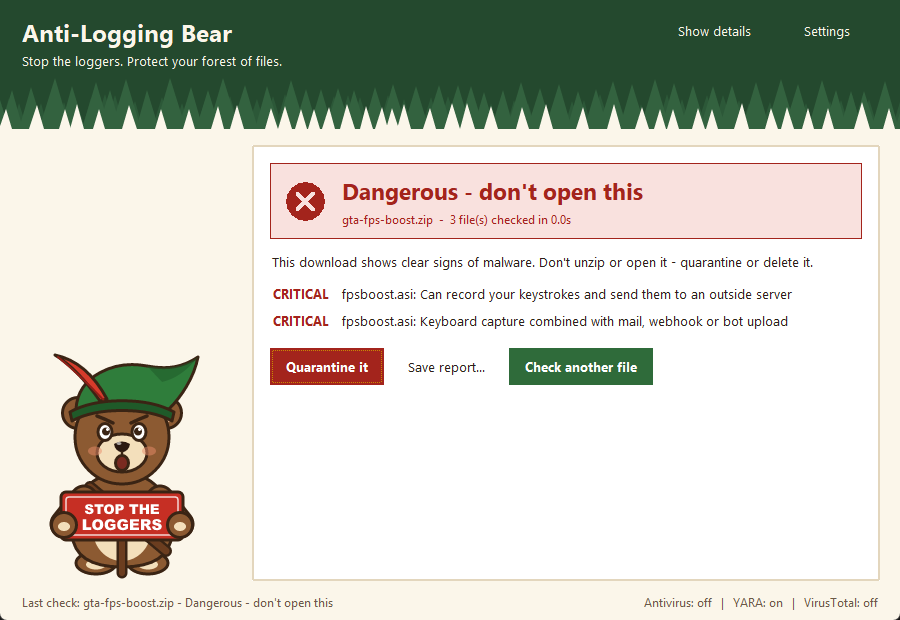
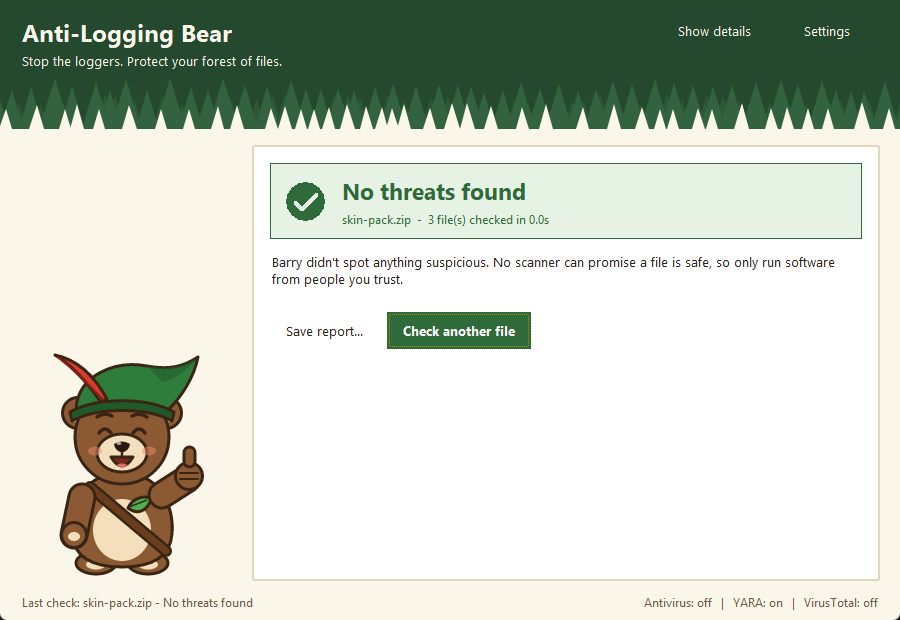
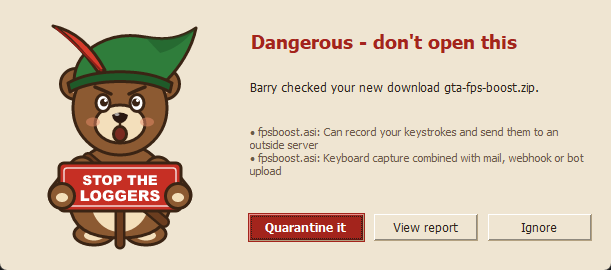
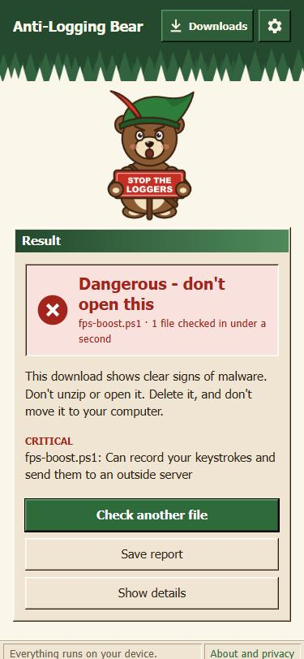
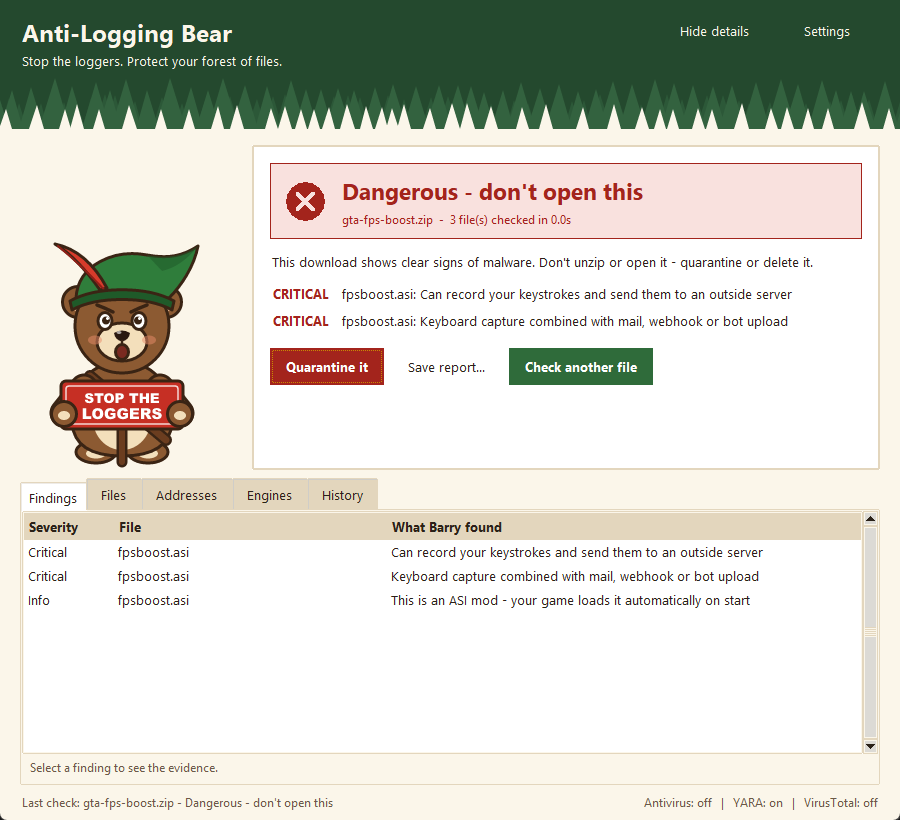

# Barry Bear

**Stop the loggers. Protect your forest of files.**

Barry Bear, the anti-logging bear, checks downloads for keyloggers, password stealers and other malware *before* you unzip or run them. Drop a zip on Barry and he reads every file inside it straight from the archive. Nothing gets extracted to disk and nothing runs.



Built for the stuff people actually download: game mods (ASI plugins, MoonLoader and CLEO scripts), cheats and trainers, tools, scripts, and documents.

## What Barry looks for

| Area | Checks |
|---|---|
| **Archives and installers** | Reads zip, 7z, RAR (every version), NSIS installers, self-extracting archives, MSI, CAB, CHM help files, ISO and DMG images, including archives inside archives, using a bundled 7-Zip that streams files straight into memory. Zip bombs, password-protected files, paths that escape the unzip folder, fake extensions (`invoice.pdf.exe`), hidden right-to-left characters |
| **Packed programs** | Unpacks PyInstaller programs and reads their Python code, reads .NET programs' imports, classes and embedded resources (and spots ConfuserEx and other obfuscators), and reads the JavaScript inside Electron apps (`app.asar`). This is where most Discord token grabbers and gaming stealers hide |
| **Programs** (`.exe` `.dll` `.asi` `.scr`) | Keyboard hooks and key polling, combined with webhook/Telegram/SMTP upload, keylogger log formatting (`[BACKSPACE]`), clipboard and screenshot capture, code injection and process hollowing, browser password and Discord token theft, start-up persistence, packers and encrypted code. Windows code signatures are verified, so tampered programs, revoked certificates and the real publisher's name show up |
| **Scripts and mods** (`.ps1` `.bat` `.vbs` `.js` `.hta` `.py` `.lua` `.cs`) | Download-and-run, encoded PowerShell (decoded and re-checked), obfuscation, antivirus tampering, Python/Lua/PowerShell keyloggers, SA-MP dialog password grabbing |
| **Documents and shortcuts** | Auto-run Office macros, remote templates, DDE, PDF JavaScript and launch actions, `.lnk` shortcuts that secretly run PowerShell or `cmd` |
| **Extra engines** | Over 10,000 community YARA rules from [YARA Forge](https://github.com/YARAHQ/yara-forge), refreshed weekly, plus Barry's own rules. A second opinion from Microsoft Defender (or ClamAV on macOS), and optional VirusTotal and MalwareBazaar fingerprint lookups |

Barry scores capabilities together rather than flagging single API calls. A mod that reads keys for hotkeys is fine. One that reads keys **and** posts to a Discord webhook is a keylogger.

| Dangerous | Clean |
|---|---|
|  |  |

## Automatic download checks

Barry can watch your Downloads folder, or any folders you choose. Each new file is checked once the browser finishes writing it. If something looks wrong, a pop-up asks whether to **Quarantine**, **View report** or **Ignore**. Quarantined files are renamed so they can't be opened, and you can restore them from Settings.



On Windows Barry runs from the system tray. On macOS he stays in the Dock.

## iPhone, iPad and Android



Barry also runs as a web app, using the same engine as the desktop version compiled to WebAssembly. It's handy for checking a mod or tool you downloaded on your phone before you send it to your PC.

1. Open **[depar1337-lab.github.io/anti-logging-bear](https://depar1337-lab.github.io/anti-logging-bear/)** in Safari (or Chrome on Android).
2. Tap **Share > Add to Home Screen**. Barry gets his own icon and works offline after the first visit.
3. Tap **Choose a file** and pick the download from the Files app. Downloads from Safari are in **Files > Downloads**.

The scan happens inside the browser. Files are never uploaded. Each file in the details view has a **VirusTotal** link that looks it up by its SHA-256 fingerprint.

The phone version can't watch your downloads, because iOS doesn't let apps do that. It also has no antivirus second opinion or YARA rules, and it checks files up to 400 MB.

<br clear="right">

## Simple by default, detailed when you want it

The main view shows a verdict and plain-English reasons. **Show details** opens the full findings table, file fingerprints (SHA-256), extracted web addresses, engine status and scan history. Reports can be saved as HTML, JSON or text.



Settings cover watched folders and exclusions, strict mode, custom YARA rules, file-size limits, VirusTotal, start at login, the Explorer right-click entry, quarantine, high-contrast colours and larger text. Everything can be done from the keyboard:

| Key | Action |
|---|---|
| Ctrl+O | Choose a file |
| Ctrl+D | Show or hide details |
| Ctrl+S | Save the report |
| Ctrl+, | Settings |
| Esc | Cancel or go back |

## Install

Download a build from the [Releases page](https://github.com/depar1337-lab/anti-logging-bear/releases/latest). The web app also offers the right download when you open it on a Windows PC or a Mac.

- **Windows 7 SP1 to Windows 11**: `BarryBear-x64-setup.exe`. Use the `x86` build on 32-bit Windows. Portable zips are also available. Windows 7 needs update KB2533623, which most patched systems already have.
- **iPhone, iPad and Android**: no install needed, see [above](#iphone-ipad-and-android).
- **macOS**: `BarryBear-macOS-AppleSilicon.dmg` for M1 or later (macOS 11+), or `BarryBear-macOS-Intel.dmg` for Intel Macs (macOS 10.15+). About This Mac shows a **Chip** on Apple silicon and a **Processor** on Intel. On Apple silicon, dragging files onto the window needs macOS 14; on older versions use **Choose a file** or **Open With**. The app isn't notarised yet, so the first time you open it, right-click it and choose **Open**. To check a file from Finder, right-click it and choose **Open With > Barry Bear**.

No administrator rights are needed. Barry installs per user, and every setting lives in your own profile.

Barry checks for new versions once a day and asks before doing anything. On an installed Windows copy, **Update now** downloads the new installer, checks its SHA-256 fingerprint against the one GitHub publishes, installs it and restarts Barry. Portable and Mac copies open the right download instead. You can turn the check off, or check by hand, in Settings > System.

## Command line

```
antiloggingbear download.zip              # text report, exit code 0 clean / 1 suspicious / 2 dangerous
antiloggingbear download.zip --json       # machine-readable
antiloggingbear download.zip --html report.html -v
antiloggingbear --gui download.zip        # open the window and check the file
antiloggingbear "C:\Games\GTA SA\modloader"  # check a whole folder
antiloggingbear --background              # start hidden and watch downloads
```

Run `antiloggingbear --help` for every option.

## Privacy

Everything runs on your computer. Files only leave it as SHA-256 fingerprints, and only if you add a VirusTotal or MalwareBazaar key; file names are never sent. Once a week Barry downloads the latest community YARA rules from GitHub, and once a day it asks GitHub whether a new version of Barry is out. Neither sends anything about you or your files, and both can be turned off in Settings. The web app works the same way: files are read inside the browser, and the only thing sent anywhere is a fingerprint, when you tap a VirusTotal link.

## Limits

No scanner can prove a file is safe. Inno Setup installers are checked as programs, but Barry can't open the files inside them yet. Windows code signatures are checked for files on disk; programs inside archives can't be checked without writing them to disk, which Barry doesn't do.

## Building from source

```
python -m venv .venv
.venv\Scripts\activate            # source .venv/bin/activate on macOS
pip install -e ".[dev,yara]"
python tools/fetch_rules.py        # bundles the YARA Forge community rules (checksum-pinned)
python -m pytest
python -m antiloggingbear
```

The community rules are stored compressed (`forge.bin`) and only ever decompressed in memory. Plain-text rule files are full of malware strings, so antivirus products flag them as malware themselves.

Release builds come from GitHub Actions (`.github/workflows/build.yml`). The Windows build uses Python 3.8, the last version that supports Windows 7, with the pinned packages in `packaging/requirements-win7.txt`. The macOS build produces an app bundle and a disk image. To build locally:

```
pyinstaller packaging/BarryBear.spec
```

The web app lives in `web/`. The build script bundles the engine with [Pyodide](https://pyodide.org) (checksum-pinned) and the pure-Python dependencies, and GitHub Actions publishes it to GitHub Pages (`.github/workflows/web.yml`). To build and try it locally:

```
python tools/build_web.py            # writes build/web
python tools/serve_web.py            # http://127.0.0.1:8765
pip download --only-binary :all: --dest .cache/web/test-wheels pytest
node tools/test_web_engine.mjs       # runs the engine tests inside the shipped Pyodide build
```

The artwork is drawn as SVG in `tools/barry.py`. `python tools/render_assets.py` regenerates the PNGs and icons in `src/antiloggingbear/assets` (it needs `resvg-py`).

## Project layout

```
src/antiloggingbear/
  engine/     archive walker, analyzers (pe, scripts, office, pdf, shortcuts), scoring, YARA, AV, VirusTotal
  rules/      bundled YARA rules
  ui/         Tk interface: main window, settings, alerts, tray
  watch/      download watcher and quarantine
  system/     paths, OS integration, notifications, single-instance handling
web/          phone and browser version: page, scan worker, offline service worker
tests/        synthetic samples generated at test time - no real malware in the repo
tools/        artwork renderer, web build, local server, Pyodide test runner
packaging/    PyInstaller spec, Inno Setup script, pinned Windows 7 requirements
```

## Licence

MIT. Made by Priest.

Community YARA rules come from [YARA Forge](https://github.com/YARAHQ/yara-forge), which collects rules from many public sources. Each rule keeps its author, reference and licence in its metadata. The sample RAR archives in `tests/fixtures` come from [rarfile](https://github.com/markokr/rarfile) (ISC licence, see `rarfile-LICENSE.txt`).
